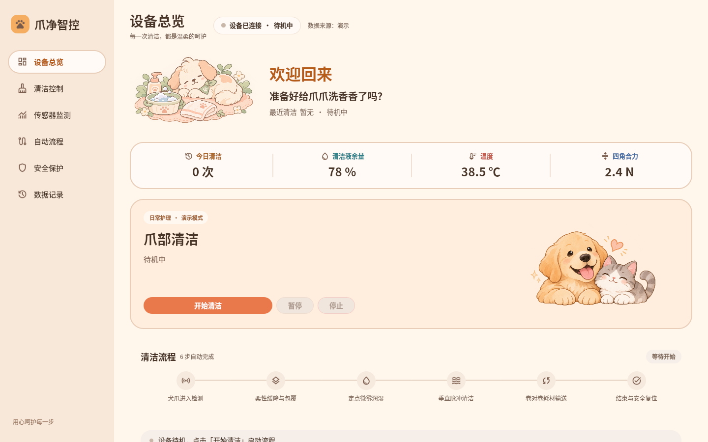
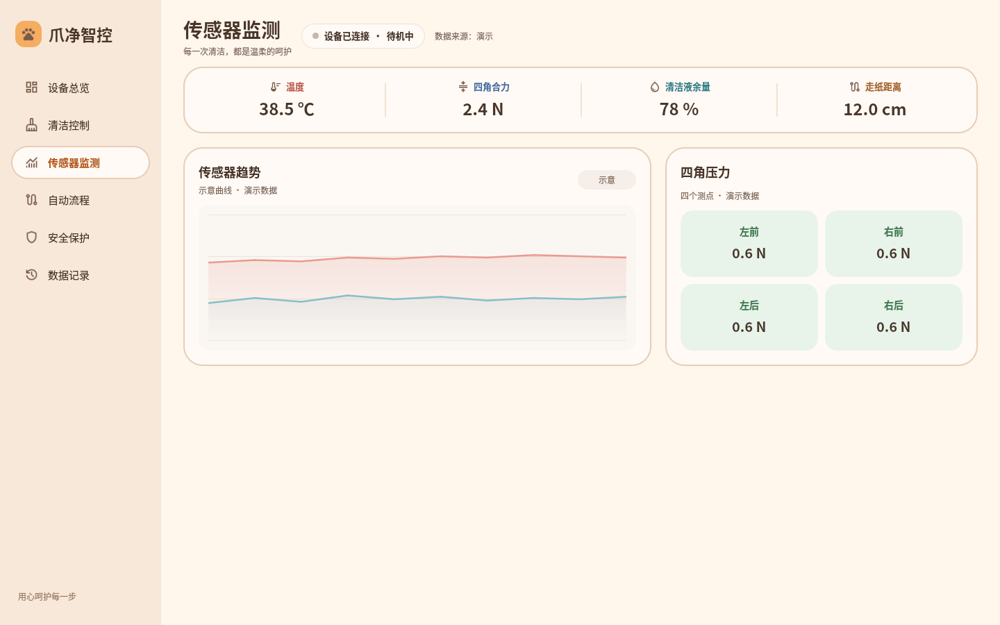
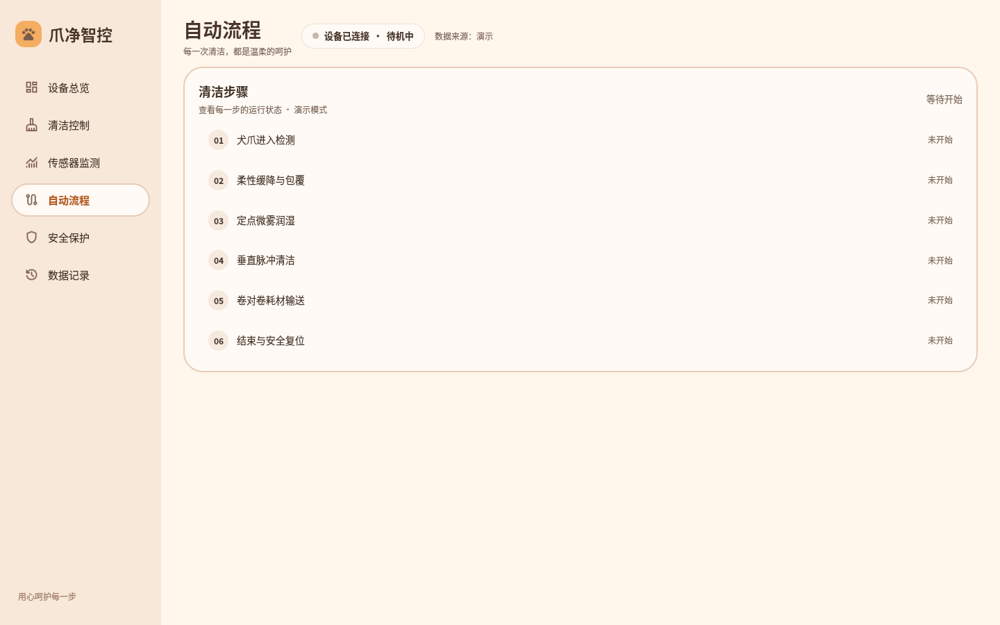

# 🐾 爪净智控 · PetCure


基于 Qt Quick 的宠物犬爪智能清洁设备桌面界面，提供设备状态、清洁流程和传感器信息的可视化展示。

> 当前版本为界面演示：数据和设备状态均为模拟内容，不连接或控制实体设备。清洁记录仅保存在内存中，退出程序后会清空。

## 📸 界面预览

### 设备总览



### 传感器监测与自动流程

| 传感器监测 | 自动流程 |
| :---: | :---: |
|  |  |

截图来自当前演示版本，界面中的数值和状态均为模拟内容。

## ✨ 功能概览

| 页面 | 功能 |
| --- | --- |
| 设备总览 | 查看清洁次数、最近清洁时间、设备状态和模拟传感器数据 |
| 清洁控制 | 开始、暂停、继续或停止模拟清洁流程 |
| 传感器监测 | 展示温度、压力、清洁液余量、走纸距离及趋势示意 |
| 自动流程 | 展示六个清洁阶段及当前进度 |
| 安全保护 | 展示模拟安全状态和报警信息 |
| 数据记录 | 查看本次运行中完成的模拟清洁记录 |

界面使用 QML 编写，包含可复用的卡片、按钮和主题组件，并支持窗口宽度变化时调整导航布局。

## 🛠️ 技术栈

- **界面**：Qt 6、Qt Quick、QML、Qt Quick Controls
- **应用入口**：C++17
- **构建**：CMake 3.16 或更高版本
- **资源**：Qt Resource System（QRC）

## 🚀 快速开始

### 环境要求

安装 C++17 编译器、CMake 和 Qt 6 开发环境，并确保 Qt 的 CMake 配置文件可被找到。项目依赖以下 Qt 模块及对应的 QML 运行时模块：

- Core、Gui、Qml、Quick、Quick Controls 2
- Qt SVG 图像插件（用于加载 SVG 图标）

### 构建与运行

在项目根目录执行：

```bash
cmake -S . -B build
cmake --build build
./build/petcure
```

如果系统安装了多个 Qt 版本，可在配置时通过 `CMAKE_PREFIX_PATH` 指定 Qt 6 的安装目录：

```bash
cmake -S . -B build -DCMAKE_PREFIX_PATH=/path/to/qt6
```

QML 文件、图标和插画通过 Qt 资源系统打包进程序。

## 📁 项目结构

```text
petcure/
├── CMakeLists.txt          # 构建配置
├── main.cpp                # 应用入口与 QML 引擎
├── qml/
│   ├── Main.qml            # 主窗口、导航和页面切换
│   ├── App.qml             # 演示状态与清洁流程
│   ├── Theme.qml           # 共享视觉主题
│   ├── components/         # 可复用界面组件
│   └── pages/              # 六个业务页面
├── docs/screenshots/       # 项目界面截图
├── assets/
│   ├── icons/              # 界面图标及第三方许可
│   └── images/             # 界面插画
└── 设计需求文档.md          # 功能需求与设计说明
```

## 📌 项目状态

目前已实现桌面界面和内存中的模拟流程。设备通信、真实传感器数据、安全联锁、报警处理及记录持久化尚未接入。后续对接实体设备时，需要根据确定的硬件能力和通信协议实现相应业务逻辑，并以设备反馈为准。

更完整的需求和设计思路请参阅 [设计需求文档](设计需求文档.md)。

## 🙏 第三方素材

导航和数据图标来自 [Google Material Symbols](https://github.com/google/material-design-icons)，已调整颜色，按 Apache License 2.0 使用。许可文本见 [assets/icons/LICENSE](assets/icons/LICENSE)。
